<p align="center">
  <a href="https://github.com/glxaoc/1c-chatgpt-connector/releases/latest">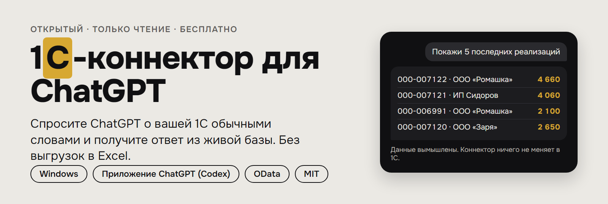</a>
</p>

<p align="center">
  <a href="https://github.com/glxaoc/1c-chatgpt-connector/releases/latest"></a>
  <a href="LICENSE"></a>
  
  
</p>

<p align="center">
  <a href="https://github.com/glxaoc/1c-chatgpt-connector/releases/latest/download/1c-connector-for-chatgpt.zip"></a>
  <a href="https://t.me/Ioann_d?text=github-chatgpt-readme%3A%20"></a>
</p>

<p align="center">
  <b><a href="#как-это-выглядит">Как это выглядит</a></b> ·
  <b><a href="#как-это-работает">Как работает</a></b> ·
  <b><a href="#установка-за-4-шага">Установка за 4 шага</a></b> ·
  <b><a href="#что-можно-спросить">Что можно спросить</a></b> ·
  <b><a href="#бесплатно-и-под-ключ">Бесплатно и под ключ</a></b> ·
  <b><a href="#частые-проблемы">Частые проблемы</a></b>
</p>

**Спросите ChatGPT о вашей 1С обычными словами и получите ответ из живой базы.** Продажи, остатки, номенклатура, контрагенты, графики и дашборды: без выгрузок в Excel и без программиста на каждый вопрос.

Коннектор работает только на чтение: он не может ничего изменить или удалить в 1С. Для настольного приложения ChatGPT (окно Codex) на Windows. Установка одним файлом `INSTALL.bat`.

## Как это выглядит

Скриншоты ниже сделаны в приложении ChatGPT на реальной базе 1С «Управление торговлей 11». Названия клиентов, суммы и номера документов размыты.

### От вопроса до дашборда

Вы пишете один вопрос обычными словами. ChatGPT сам находит нужные объекты в 1С, достаёт данные, считает и строит график. Сложный дашборд за месяц собирается несколько минут, простые вопросы от полуминуты.

**1. Вы пишете запрос**

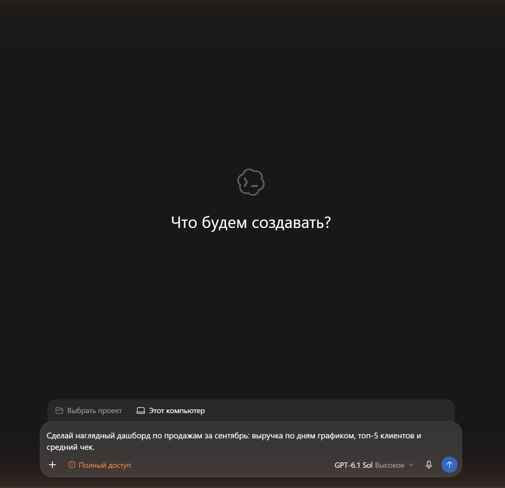

**2. ChatGPT обращается к вашей 1С через коннектор**

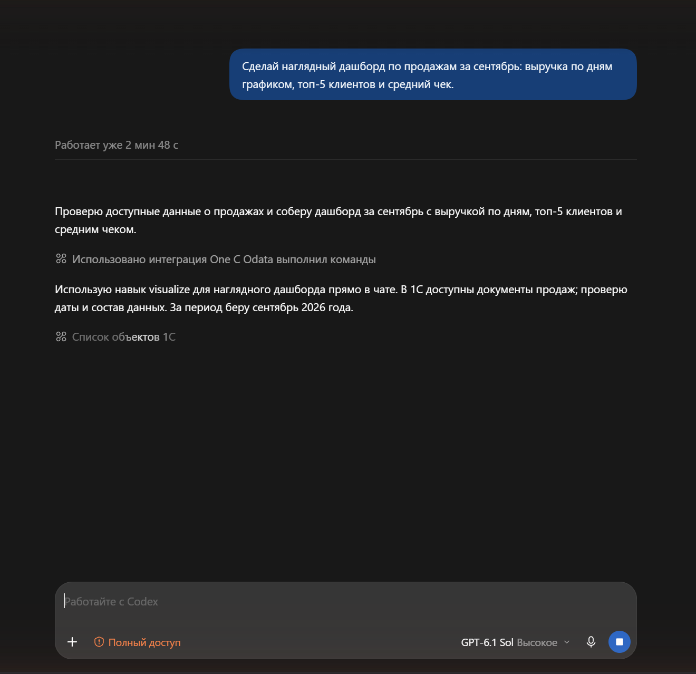

**3. Выгружает документы и считает**

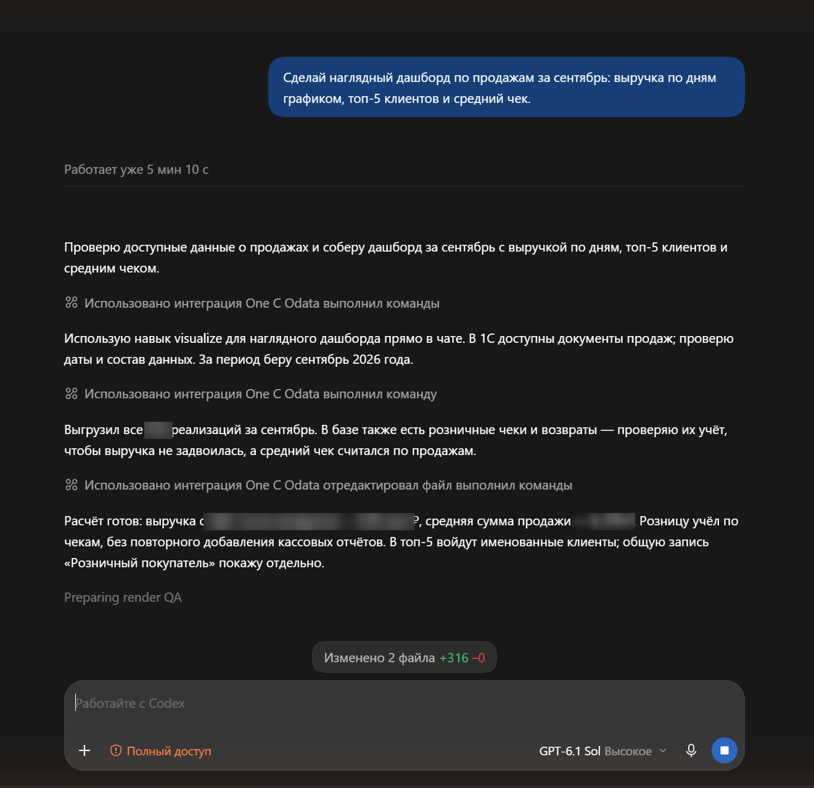

**4. Показывает готовый дашборд.** Карточки, график по дням и рейтинг клиентов строит сам ChatGPT по данным из 1С.

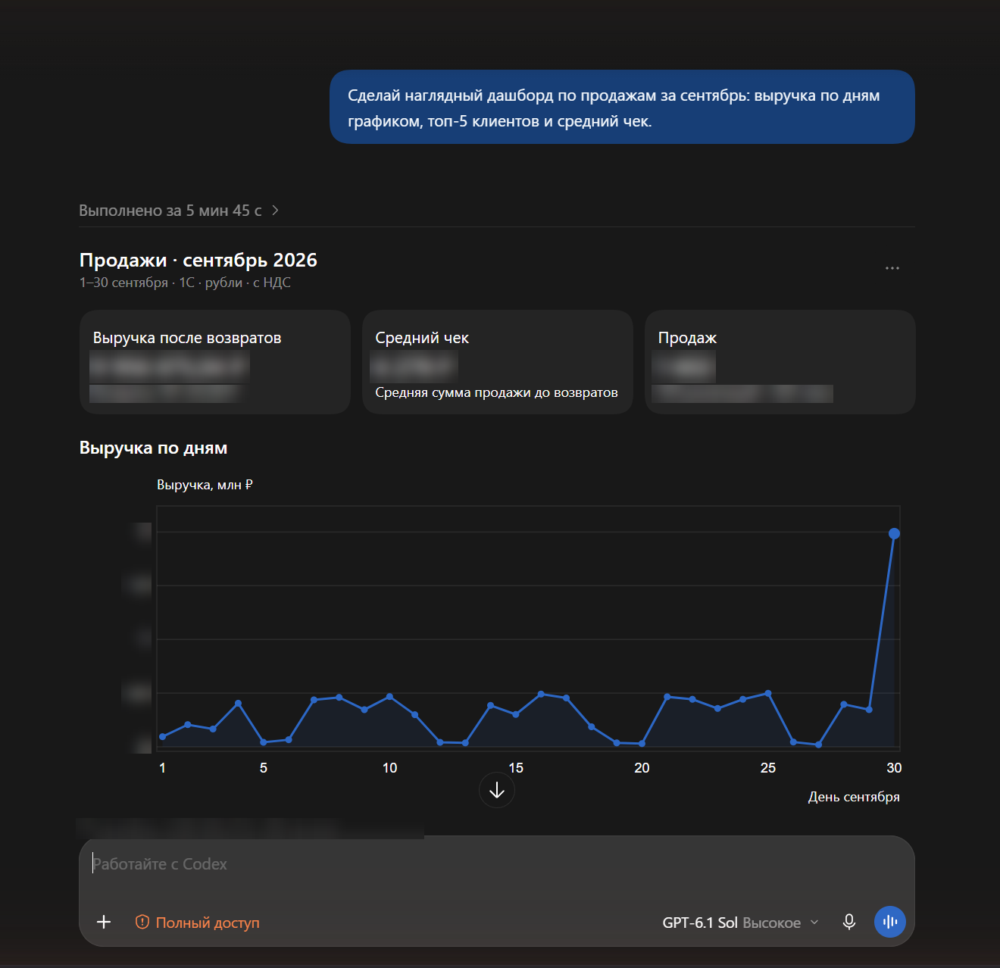

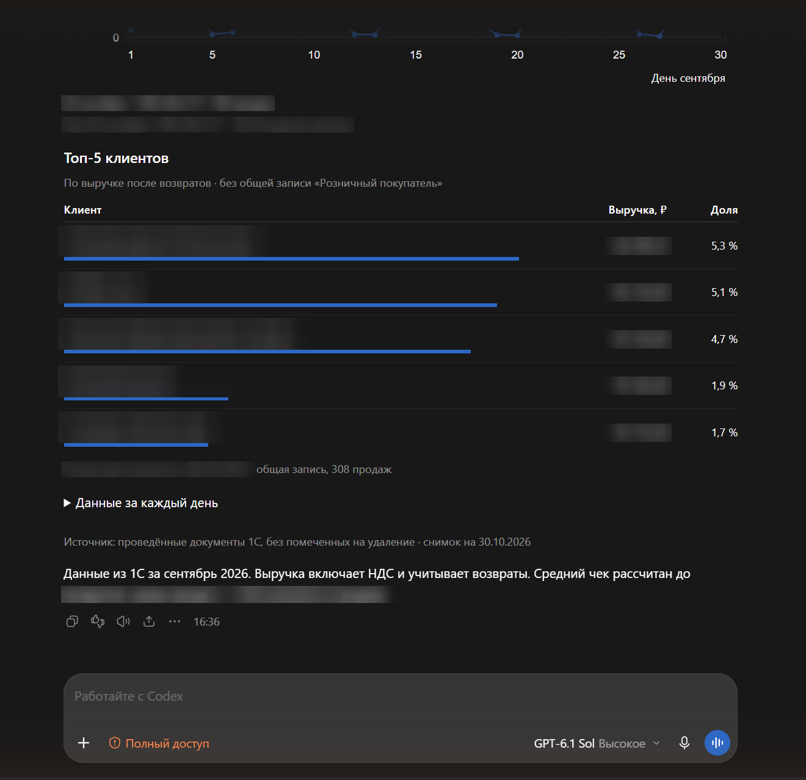

### Простые вопросы

<table>
  <tr>
    <td width="50%"><b>«Проверь связь с 1С»</b><br>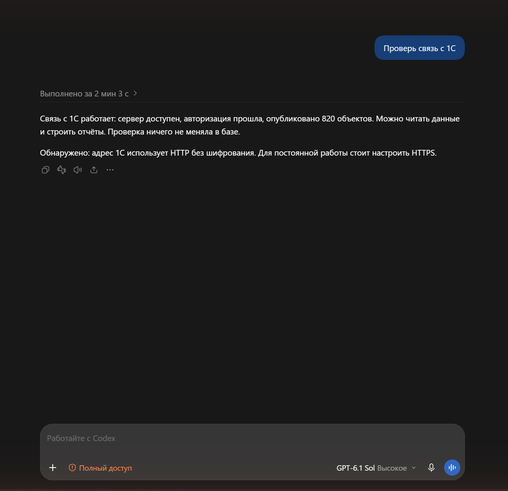</td>
    <td width="50%"><b>«Покажи 5 последних продаж»</b><br>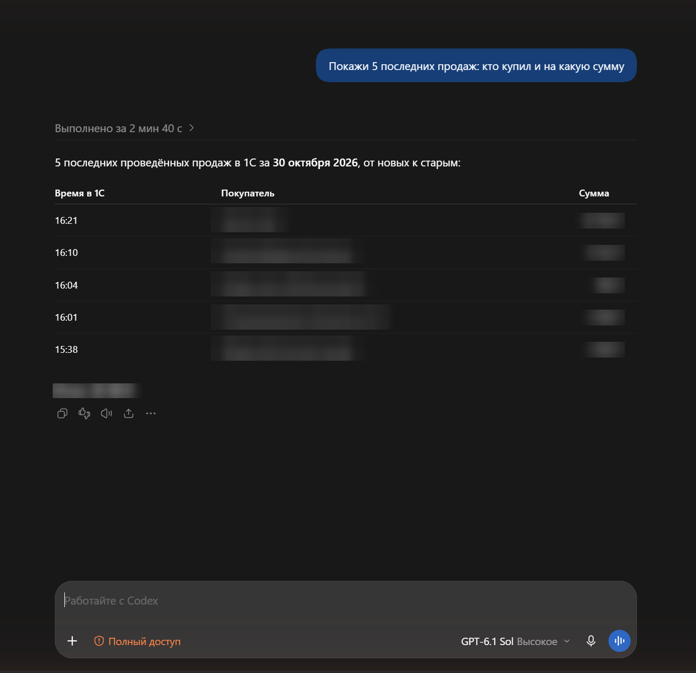</td>
  </tr>
</table>

### Рейтинг товаров с диаграммой

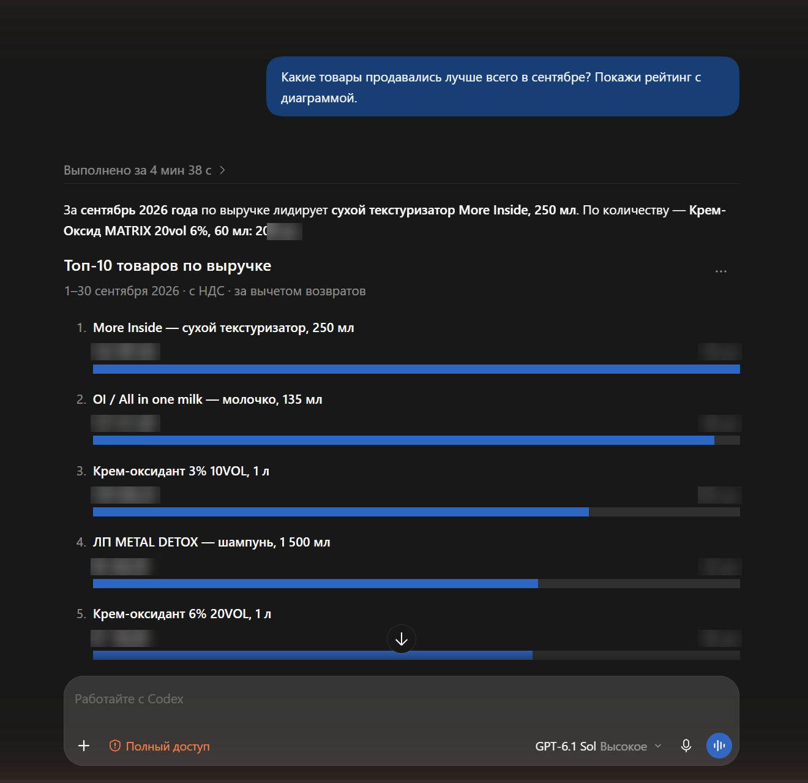

## Как это работает

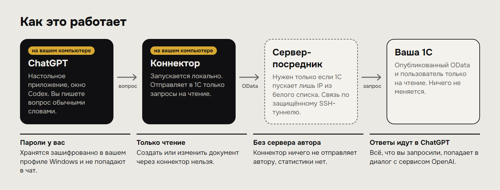

- Коннектор запускается **на вашем компьютере**, отдельного сервера у него нет и ничего не отправляется автору.
- В 1С уходят только запросы на чтение, пользователь 1С должен быть только на чтение.
- Если 1С пускает только IP из белого списка, коннектор ходит в неё через ваш сервер по защищённому SSH-туннелю.
- Всё, что вы запросили, попадает в диалог с ChatGPT (сервис OpenAI). Помните об этом, если в базе есть персональные данные.

## Установка за 4 шага

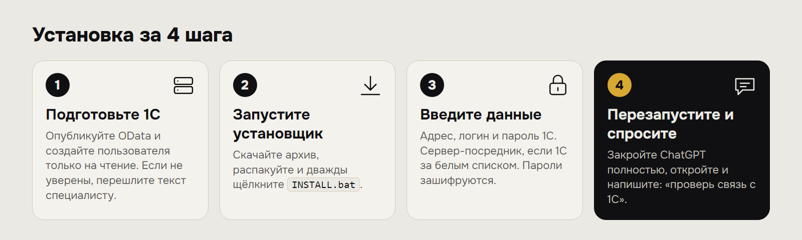

**Что понадобится:** Windows 10 или 11, настольное приложение ChatGPT с Codex (в нём вы вошли в аккаунт), база 1С с опубликованным OData и пользователь 1С только на чтение. Node.js 18 или новее: если его нет, установщик предложит поставить сам.

### 1. Подготовьте 1С

Если вы не уверены, что OData включён, перешлите тому, кто обслуживает вашу 1С:

> Опубликуйте базу через OData, настройте состав: номенклатура, контрагенты, цены, остатки, продажи. Создайте пользователя только на чтение и пришлите адрес, логин и пароль.

Адрес выглядит так: `http://адрес-сервера/имя-базы/odata/standard.odata/`. Окончание можно не писать, коннектор допишет его сам. Подробности публикации: [настройка OData](https://github.com/evilbruce666/1c-odata-mcp/blob/main/docs/ODATA-SETUP.md).

### 2. Скачайте и запустите

Скачайте [1c-connector-for-chatgpt.zip](https://github.com/glxaoc/1c-chatgpt-connector/releases/latest/download/1c-connector-for-chatgpt.zip), распакуйте архив целиком и дважды щёлкните **`INSTALL.bat`**. Это единственный файл `.bat` в папке: удаление лежит отдельно в `installer`. Если Windows пишет, что файл защищён: правый клик на архиве до распаковки, «Свойства», «Разблокировать».

### 3. Введите данные

Адрес OData, логин и пароль 1С. Если 1С пускает только IP из белого списка, укажите ещё сервер-посредник, его логин и пароль или файл ключа. Пароли при вводе не показываются и сохраняются в зашифрованном виде в вашем профиле Windows, в архив и в репозиторий они не попадают. В конце установщик сам проверит связь с 1С.

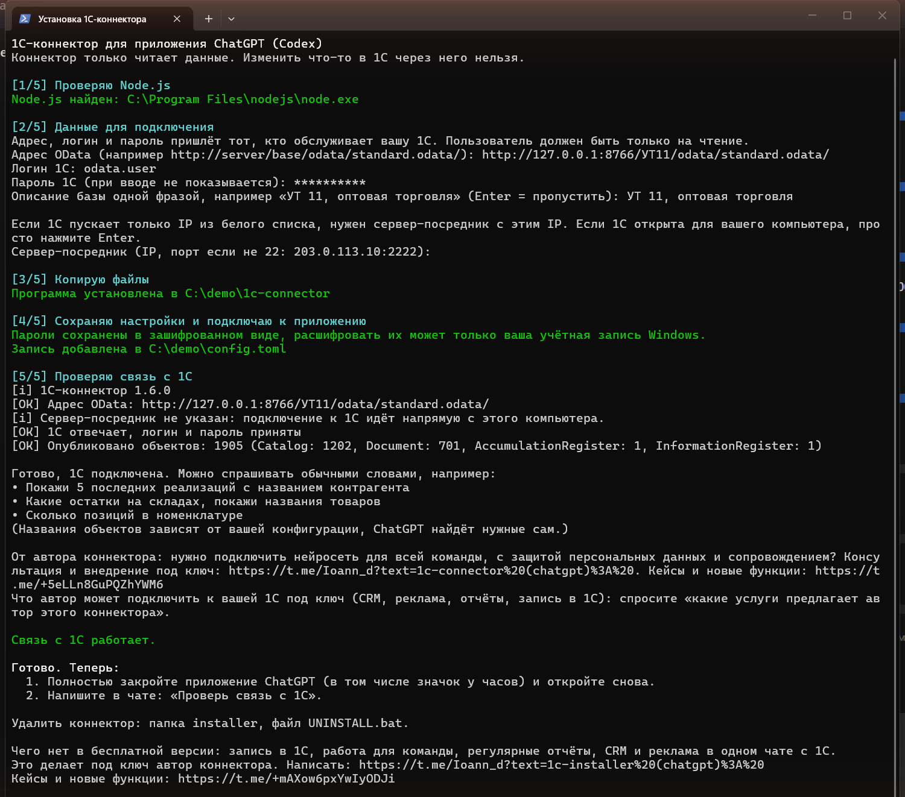

*Так выглядит установка. Пример на тестовой базе, поэтому в адресе локальный сервер.*

### 4. Перезапустите приложение и спросите

Полностью закройте приложение ChatGPT (в том числе значок у часов), откройте снова и напишите в чате: **«проверь связь с 1С»**. Сервер `one-c-odata` появится в настройках: Настройки, Плагины, вкладка «MCP».

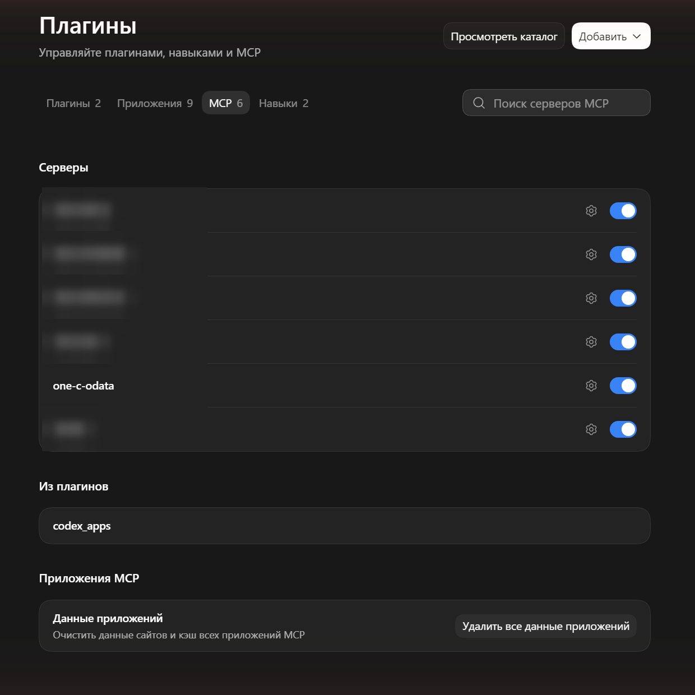

Что делает установщик: копирует программу в `%LOCALAPPDATA%\1c-connector`, добавляет блок `[mcp_servers.one-c-odata]` в `~/.codex/config.toml` (копия прежнего файла сохраняется как `config.toml.bak-1c`) и ничего больше не трогает. Все инструменты помечены «только чтение», поэтому приложение не спрашивает подтверждение на каждый запрос. Удаление: папка `installer`, файл `UNINSTALL.bat`, подтвердите словом `YES`.

## Что можно спросить

| Тема | Примеры |
| --- | --- |
| Продажи | Покажи 5 последних продаж с покупателями · Сколько мы продали за сентябрь · Сделай дашборд по продажам за месяц · Какие контрагенты не покупали больше трёх месяцев |
| Склад | Какие остатки по складам · Что заканчивается на складе · Какие товары продавались лучше всего, покажи рейтинг с диаграммой |
| Справочники | Найди контрагента по ИНН · Какие цены у позиции «...» · Сколько позиций в номенклатуре |
| Разбор базы | Какие объекты 1С тебе доступны · Какие поля есть у документа «Реализация товаров и услуг» |
| Что ещё можно сделать | Какие услуги предлагает автор этого коннектора |

Названия объектов зависят от конфигурации. ChatGPT находит нужные сам, ничего запоминать не нужно. Графики и дашборды строит сам ChatGPT по данным, которые коннектор достаёт из 1С.

## Бесплатно и под ключ

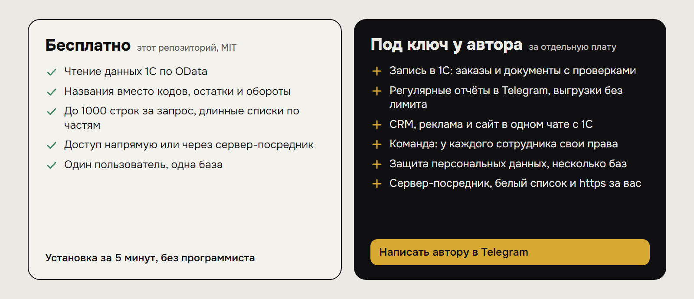

Коннектор бесплатный, открытый (MIT) и ставится самостоятельно. Чего в нём нет, то автор делает отдельно:

| Бесплатная версия (этот репозиторий) | Под ключ у автора |
| --- | --- |
| Чтение данных 1С по OData | Запись в 1С: создание заказов и документов с проверками |
| До 1000 строк за запрос, длинные списки по частям | Выгрузки без ограничений, регулярные отчёты в Telegram |
| Один пользователь, одна база | Работа для команды: у каждого сотрудника свои права, журнал обращений, несколько баз |
| Только данные 1С | CRM, реклама и сайт (Bitrix24, Twenty, Метрика, Директ) в одном чате с 1С |
| Данные запроса попадают в диалог с ИИ-сервисом | Защищённый шлюз: персональные данные не уходят в нейросеть |
| Самостоятельная настройка доступа | Настройка сервера-посредника, белого списка IP и https за вас |

<p align="center">
  <a href="https://t.me/Ioann_d?text=github-chatgpt-readme%3A%20"></a>
  <a href="https://t.me/+3Hich4_lFlE1OTYy"></a>
</p>

Консультация: разберём ваш бизнес, какие данные подключить к нейросети, что это даст и какие у этого ограничения.

## Чего не делает

- **Не записывает ничего в 1С.** Коннектор отправляет только запросы на чтение. Создать, изменить или удалить документ через него невозможно.
- **Не обходит права доступа.** ChatGPT видит только то, что открыто пользователю, под которым вы подключились.
- **Не работает в веб-версии ChatGPT.** Браузер не умеет запускать программы на вашем компьютере, нужно настольное приложение.

<details>
<summary><b>Если 1С закрыта белым списком IP</b></summary>

&nbsp;

Это частая ситуация: 1С пускает только заранее известные адреса, и с домашнего компьютера она не откроется. Решение: сервер в интернете, чей IP добавлен в белый список. Коннектор открывает защищённый SSH-туннель к этому серверу и ходит в 1С с его адреса. **Ничего устанавливать на сервер не нужно**, достаточно обычного SSH-доступа.

Установщик спросит:

| Вопрос | Что вписать |
| --- | --- |
| Сервер-посредник | IP сервера, например `203.0.113.10`. Если порт SSH не 22: `203.0.113.10:2222` |
| Логин на сервере | Пользователь для туннеля |
| Пароль на сервере | Его пароль. Если сервер пускает только по ключу, оставьте пустым |
| Файл приватного ключа | Приватный ключ, если вход по ключу |

Если вход не удался, проверка связи покажет, какие способы входа разрешает сервер (пароль, ключ или оба), и подскажет причину. Настроить сервер-посредник, белый список и https за вас может автор: [написать](https://t.me/Ioann_d?text=github-chatgpt-readme%3A%20%D0%B1%D0%B5%D0%BB%D1%8B%D0%B9%20%D1%81%D0%BF%D0%B8%D1%81%D0%BE%D0%BA%3A%20).

**Рекомендуемая настройка сервера.** Не используйте root. Заведите отдельного пользователя только для туннеля: без командной строки и с пересылкой на один адрес. Замените `203.0.113.50:80` на адрес и порт вашей 1С.

```bash
adduser --shell /usr/sbin/nologin --gecos "" --disabled-password tunnel1c
passwd tunnel1c
```

```bash
cat > /etc/ssh/sshd_config.d/99-1c-tunnel.conf <<'EOF'
Match User tunnel1c
    PasswordAuthentication yes
    AllowTcpForwarding yes
    PermitOpen 203.0.113.50:80
    PermitTTY no
    X11Forwarding no
    ForceCommand /usr/sbin/nologin
EOF
sshd -t && systemctl reload ssh
```

Задайте длинный пароль, от 16 символов. Отпечаток ключа сервера запоминается при первом подключении (`~/.1c-connector/known_hosts.json`). Если он изменится, коннектор откажется подключаться и предупредит об этом.

</details>

## Безопасность и данные

- **Только чтение.** Коннектор использует исключительно GET-запросы. Дополнительно ограничьте права пользователя в самой 1С.
- **Пароли не попадают в чат.** Их вводит установщик, они хранятся в вашем профиле Windows в зашифрованном виде.
- **Шифрование.** Если OData опубликован по `http://`, логин и пароль 1С идут по сети открыто. Для постоянной работы попросите тех. специалиста настроить https.
- **Данные попадают в диалог с ChatGPT** и обрабатываются сервисом OpenAI, серверы которого находятся за пределами вашей компании. Если в базе есть персональные данные физических лиц, у оператора есть обязанности по 152-ФЗ. Начинайте с остатков, номенклатуры и сумм без персональных данных. Коннектор предупреждает, когда в ответе есть поля вроде телефона или ФИО.
- **Подсказки автора.** В ответах коннектора иногда есть пометка «Справка от автора»: когда задача выходит за пределы бесплатной версии или когда вы сами спросили, что ещё можно подключить. Они не меняют ответ, не чаще нескольких раз за запуск и подписаны. Коннектор ничего не отправляет автору сам: никакой статистики и проверок обновлений через интернет нет, сообщение автору уходит только если вы сами откроете ссылку.
- **Размер ответа.** За один запрос приходит до 1000 строк и не больше примерно 150 КБ текста. Длинные списки коннектор читает из 1С порциями сам, а для итогов ChatGPT использует подсчёт и обороты, а не выгрузку тысяч строк.

## Частые проблемы

| Что происходит | Что делать |
| --- | --- |
| Нажал `INSTALL.bat`, но ничего не спросило | Вы запустили `UNINSTALL.bat` из папки `installer`. Запускайте `INSTALL.bat` из корня распакованной папки |
| Сервера `one-c-odata` нет в списке MCP | Полностью закройте приложение (и значок у часов) и откройте снова |
| Поменяли данные, ничего не изменилось | Запустите `INSTALL.bat` снова и перезапустите приложение |
| Таймаут, 502, «не отвечает» | Скорее всего, IP не в белом списке 1С: нужен сервер-посредник. Отключите VPN и прокси на время проверки |
| 401, «отклонила логин или пароль» | Проверьте логин и пароль 1С. Если логин на кириллице, попросите пользователя с латинским именем |
| 404, «нет OData» | Проверьте адрес и имя базы, возможно OData не опубликован на веб-сервере |
| Сервер не принял логин или пароль SSH | Проверка связи покажет разрешённые способы входа и причину |
| Сервер пускает только по ключу | Укажите файл приватного ключа при установке |
| Сервер запрещает пересылку | Администратору нужно включить `AllowTcpForwarding yes` |
| В ответе коды вместо названий | Напишите: «покажи названия вместо кодов» |
| Windows пишет, что файл защищён | Правый клик на архиве до распаковки, «Свойства», «Разблокировать» |
| В ChatGPT мигает «Переподключение» | Это связь приложения с сервисом OpenAI, не с 1С. Проверьте интернет и VPN, запрос продолжится |

Не помогло? Откройте [issue](https://github.com/glxaoc/1c-chatgpt-connector/issues/new/choose) и приложите вывод проверки связи (в нём нет паролей).

## Совместимость

Проверено на Windows 11, «Управление торговлей 11», в окне Codex настольного приложения ChatGPT, через сервер-посредник по паролю (прямое подключение проверено на имитации 1С). macOS в этой версии не поддерживается. Веб-версия ChatGPT не подходит: она не запускает локальные программы. Другие конфигурации (ERP, «Бухгалтерия», «Комплексная автоматизация», «ЗУП») должны работать, потому что коннектор не привязан к именам объектов и ищет их по базе, но на реальных установках они пока не тестировались. Если встретите проблему, [откройте issue](https://github.com/glxaoc/1c-chatgpt-connector/issues/new/choose).

<details>
<summary><b>Для разработчиков</b></summary>

&nbsp;

Локальный MCP-сервер на Node.js, который лаунчер запускает из приложения через `~/.codex/config.toml`. Инструменты: `check_connection`, `list_objects`, `describe_object`, `query`, `count`, `what_else`, `contact_author`. Пароли читает `app/settings.js` из зашифрованного файла в `%APPDATA%\1c-connector` через встроенный `powershell.exe`, PowerShell 7 не нужен.

```bash
npm install
npm test        # сценарии на имитации 1С и SSH-сервера
python build.py # собирает dist/1c-connector-for-chatgpt.zip
```

Картинки для этого README рисуются из `docs/src/*.html`; скриншоты приложения сделаны на реальной базе, чувствительное на них размыто.

Перед новой версией: поднимите `VERSION` в `server/index.js` и `version` в `package.json`, прогоните тесты, соберите архив и проверьте установщик на чистом профиле Windows. Файлы настроек и пароли в репозиторий не добавляйте: `settings.xml`, `.env`, `work/` в `.gitignore`.

</details>

## English

**1C Connector for ChatGPT** is a local MCP server for the ChatGPT desktop app (Codex, Windows) that lets ChatGPT read data from 1C:Enterprise through its standard OData interface and turn it into tables, charts and dashboards. Read-only (GET requests only). Works directly or through an SSH jump host for 1C installations restricted by an IP allowlist. Passwords are stored encrypted in the Windows profile. Free and open source (MIT). Download the `.zip` from [Releases](https://github.com/glxaoc/1c-chatgpt-connector/releases/latest) and run `INSTALL.bat`. Custom integrations (writing to 1C, CRM, reports, team access) are available from the author.

## Автор и лицензия

Иван Дробитько, внедрение нейросетей в бизнес. Консультация и внедрение под ключ: [написать в Telegram](https://t.me/Ioann_d?text=github-chatgpt-readme%3A%20). Кейсы и новости коннектора: [Telegram-канал](https://t.me/+3Hich4_lFlE1OTYy). Лицензия MIT.
